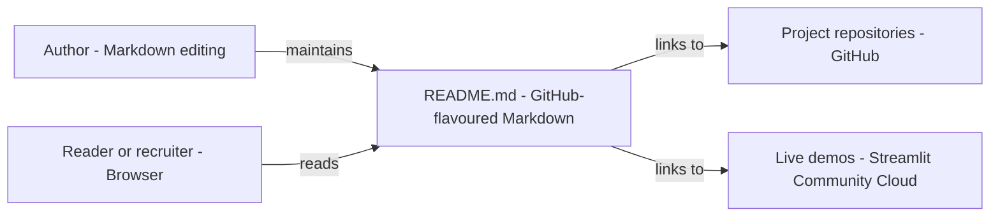

# Project Portfolio index - Architecture and design rationale

*Last updated: 2026-11-07 · commit 8a9bd36d4*

## 1. Purpose and scope

A portfolio index: one README that lists Elliott Fairhall's data engineering, analytics and machine learning
repositories with a title, a one-line description, key features, the tech stack, and a live-demo badge where one exists.
It holds no project code, only pointers. It is not a live inventory and is not generated from the repositories.

## 2. How this project was built

This project was built with Claude Code (Anthropic's AI coding assistant) in a complementary role. Elliott Fairhall is
the author and owner: the portfolio entries describe his own projects, which he builds, debugs, tests and uses for
learning and development. The repository is content only, and its short history (five commits, mostly restoration and
formatting) does not record how each entry was drafted, so no claim is made about which passages were AI-assisted.

## 3. Architecture at a glance

- The author maintains one file; it links to project repositories and live demos; readers only read.

The README is the only artefact. Its sections group projects by theme: Streamlit apps, Snowflake data engineering,
Snowflake tutorials and cloud infrastructure, with a contact section at the end.

## 4. Components

| Component             | Responsibility                                        | Key files   | Depends on                            |
| --------------------- | ----------------------------------------------------- | ----------- | ------------------------------------- |
| Streamlit suite       | Five analytics and ML apps with demo badges           | `README.md` | Project repos, Streamlit-hosted demos |
| Snowflake engineering | Warehouse project summary                             | `README.md` | Project repo                          |
| Snowflake tutorials   | Learning exercises (Time Travel, cloning and similar) | `README.md` | Tutorial repos                        |
| Cloud infrastructure  | Cross-cloud sync pipeline summary                     | `README.md` | Project repo                          |
| Connect               | Website, GitHub and LinkedIn links                    | `README.md` | External profiles                     |

Curation model: every entry follows the same four-part template (name and link, subtitle, key features, tech stack). The
repeated template lets a reader compare projects quickly and makes new entries mechanical to add.

## 5. Data and control flow

No runtime and no automation. The owner edits the README and commits; the monorepo mirrors the folder to the standalone
repository. The only failure mode is drift: a project is renamed, moved or archived, or a hosted demo is removed, and
the index still points to it. Nothing detects that.

## 6. Design rationale

### One README as the portfolio index

- **Why:** the portfolio's substance is in the individual repositories. A single page that links to them needs no build
  or hosting and is visible on the owner's GitHub account immediately.
- **Gave up:** no search or filtering, no screenshots, and no automatic update when a project changes.
- **Alternative not taken:** the projects page on the Data Flakes site, which supports richer layout but needs a site
  deployment. The two overlap in purpose (TODO: verify how they are kept in step).
- **Evidence:** inferred from the repository shape (one file) and its history.

### A fixed entry template

- **Why:** consistent name, description, features and stack let a reader scan a dozen projects in a minute, and keep
  adding a project to a copy-and-edit task.
- **Gave up:** each project's distinguishing story is compressed to a few bullets.
- **Alternative not taken:** free-form write-ups, or a generated table from repository metadata.
- **Evidence:** inferred from the README structure.

### Live-demo badges for Streamlit projects

- **Why:** a running app proves more than a description, and a badge is one line of Markdown.
- **Gave up:** demos on free hosting can sleep or be removed, and the index cannot tell.
- **Alternative not taken:** screenshots or GIFs stored in the repository, which would not go stale but are not
  interactive.
- **Evidence:** inferred from the README.

### Grouping by theme, with Snowflake tutorials separate from projects

- **Why:** the owner's focus is Snowflake and data engineering; separating finished projects from tutorials shows depth
  without mixing practice exercises with applications.
- **Gave up:** a project that fits two groups appears once.
- **Alternative not taken:** chronological or alphabetical listing.
- **Evidence:** inferred from the section headings.

## 7. Quality and testing

None automated: no link checker, and no check that listed repositories or demo URLs still resolve. The parent repository
runs Markdown linting through pre-commit hooks (TODO: verify it applies here). Commit `7629d6a24` fixed pre-commit hook
issues for the folder in its early history.

## 8. Constraints, limitations and known gaps

- Entries are accurate only as of the last manual edit; no date is shown per entry.
- Descriptions use marketing-style titles ("Intelligence Flux", "Sentiment Dynamics") that differ from repository names;
  readers rely on the link text to match them.
- The same featured projects appear in the Resources repository; the two lists can disagree.
- The contact section duplicates links held elsewhere (profile README, website).

## 9. Running and extending

Edit `README.md`, copy an existing entry, and keep the four-part template and section order. Check each link in a
browser before committing. If the list grows past about twenty entries, consider generating it from a data file.

## 10. Rationale (confirmed by the owner)

Confirmed by Elliott Fairhall on 2026-11-07. This reasoning was first reconstructed from the code and commit history;
the owner has since agreed it is correct, so it is now the stated rationale rather than an inference.

- A README index was preferred over a site page to avoid a deployment.
- The fixed entry template was chosen for scan-ability and low effort.
- Demo badges were used in place of screenshots for interactivity.
- Tutorials are separated from projects to keep finished work distinct from practice.
